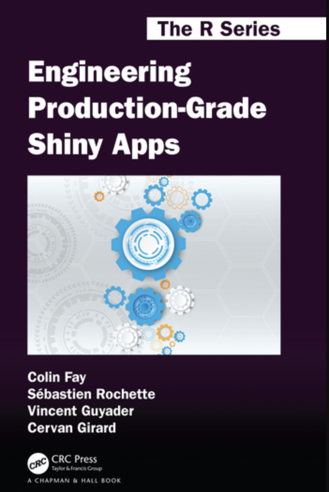
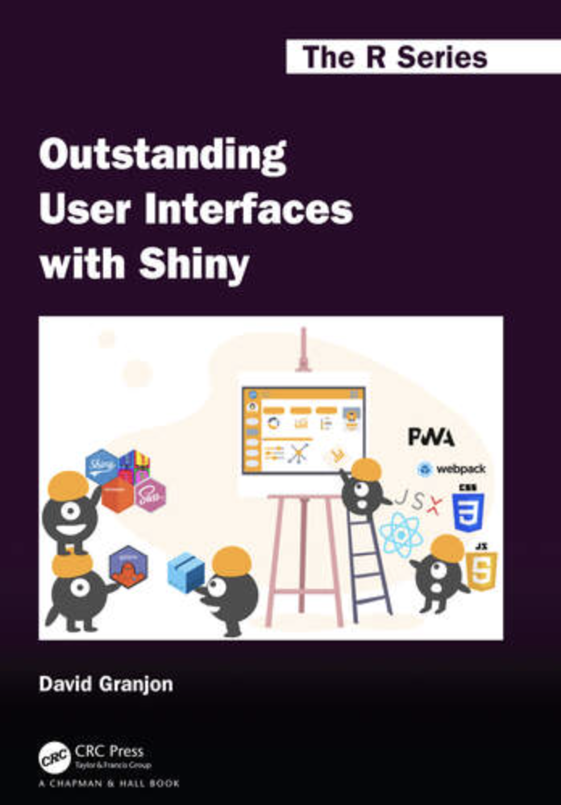

# Introduction {#sec-intro .unnumbered}

```{r}
#| eval: true
#| echo: false
#| include: false
source("_common.R")
"#3a506b"
```

Using R package development practices when building Shiny applications saves time and makes collaboration easier. Packages give your code clear structure and make it simple for others to install, use, and understand your work. This book teaches you how to combine Shiny and R package development into a cohesive workflow.

## Why this book?

:::: {layout="[75, 25]" layout-valign="top"}

[R Packages, 2ed](https://r-pkgs.org/) is the authoritative guide to package development, but it doesn't cover Shiny. 

{class="cover" width="300" fig-align="right"}

::::


:::: {layout="[25, 75]" layout-valign="top"}

{class="cover" width="300" fig-align="left"}

[Mastering Shiny](https://mastering-shiny.org/) teaches application design and reactivity, but package development remains optional and brief. If you've read one and wanted the other, you've hit a gap this book fills.

::::

This book combines both approaches through worked examples of a complete Shiny app-package: structure, testing, documentation, deployment. Most developers have existing Shiny applications they want to turn into packages, so we'll organize chapters around that journey rather than building from scratch. 

## Other resources

The Shiny community has published other excellent resources.

:::: {layout="[75, 25]" layout-valign="top"}

[Engineering Production-Grade Shiny Apps](https://engineering-shiny.org/) introduces the `golem` framework for standardized app development. 

{width="150" fig-align="left"}

::::

:::: {layout="[25, 75]" layout-valign="top"}

{width="220" fig-align="left"}

[Outstanding User Interfaces with Shiny](https://unleash-shiny.rinterface.com/) addresses UI customization with HTML, CSS, and JavaScript. We'll cover these frameworks in the later chapters if they fit your needs.

::::

## Why packages for Shiny?

[Do future you a favor.]{style='font-size: 1.15em; font-style: italic; font-weight: bold; color: #3a506b;'}

Standardizing your projects saves setup time and ramp-up across applications. Using an R package structure gives you access to IDE tools (RStudio and Positron) for testing, documentation, and installation. A package is a boundary: it forces clarity about what's internal and what you expose to users.

[Assume someone else will read your code.]{style='font-size: 1.15em; font-style: italic; font-weight: bold; color: #3a506b;'}

R packages provide a standard interface for sharing code. When others (or future you) encounter your Shiny app, a package makes it obvious where to find what, how to install it, and how to run it. No guessing about file paths or setup steps.

## How to read this book

The chapters roughly follow the steps of package development, applied to an existing Shiny application. Each topic can work on its own, but together they form a complete workflow.

[The first two sections](app_packages.qmd) cover the stable fundamentals: the "whole game" of building an app-package, Shiny structure, package basics, and development tools. These topics won't change anytime soon.

The remaining sections are opinionated approaches to [debugging](debug.qmd), [testing](tests.qmd), and [deployment.](deploy.qmd) Many practices come from [R Packages, 2ed](https://r-pkgs.org/) and the Shiny community, but there are always multiple ways forward.

:::: {.callout-tip collapse='false' appearance='default' icon=false}

If you find yourself getting frustrated, try the 15-minute rule: **force yourself to attempt something for 15 minutes, then ask for help**. The act of struggling teaches you more than a quick answer, and explaining your attempt to someone else often surfaces the solution.

::::

## Development environments

The chapters demonstrate RStudio and Positron (Posit's new IDE for multiple languages). Most workflows are the same in both—I'll use icons to flag differences.

::: {layout="[80, 20]" layout-valign="top"}

RStudio is the established IDE for R package development. Its **Build** pane and tight integration with `devtools` streamline testing, documenting, and installing packages.

{width="150" fig-align="right"}

:::

::: {layout="[20, 80]" layout-valign="top"}

{width="150" fig-align="left"}

Positron is Posit's new IDE, designed to be sleek and performant across multiple languages while keeping powerful tools for debugging and visualization. It's under active development, so some features may still be arriving.

:::

Package development outside an IDE (VS Code, command line, etc.) works the same way. You'll call the same functions (`roxygen2::roxygenize()`, `devtools::load_all()`, `devtools::install()`), just without the point-and-click shortcuts.

## Acknowledgments

This book came from conversations with Shiny developers new to packages, package authors learning Shiny, and new R users building robust applications. I'm grateful to:

- [Henry Bernreuter](https://github.com/HenryBernreuter) & [Elizabeth Marshallsay](https://www.youtube.com/@lilybuguk) for the initial discussions that created the outline for this book  
- [Andrew Bates](https://github.com/asbates) for being an exemplary developer and professional, quietly building outstanding UIs, applications, and packages 
- [Eric Simms](https://github.com/esimms999) for asking so many great questions, reviewing chapters, and giving phenomenal feedback  
- [Eric Nantz](https://github.com/rpodcast)[^nantz-linkedin] for his [R podcast](https://r-podcast.org/), [Shiny developer series](https://shinydevseries.com/), [workshops](https://posit-conf-2023.github.io/shiny-r-prod/), and everything else he does for the Shiny community   
- [Philip Bowsher](https://github.com/philbowsher) for everything he does for the R/Pharma conference and community  
- [Ted Laderas](https://github.com/laderast) for his excellent [gRadual intRoduction to Shiny](https://laderast.github.io/gradual_shiny/) course and insightful blog posts  
- [Jennifer Bryan](https://github.com/jennybc) and [Hadley Wickham](https://github.com/hadley) for their posit::conf(23) [package development masterclass workshop.](https://github.com/posit-conf-2023/pkg-dev-masterclass) 
- [Maya Gans](https://github.com/MayaGans) for having multiple conversations and Shiny modules and package dependencies
- [Leon Samson](https://github.com/LDSamson) for his feedback on the testing chapters

[^nantz-linkedin]: Eric's [LinkedIn](https://www.linkedin.com/in/eric-nantz-6621617)
