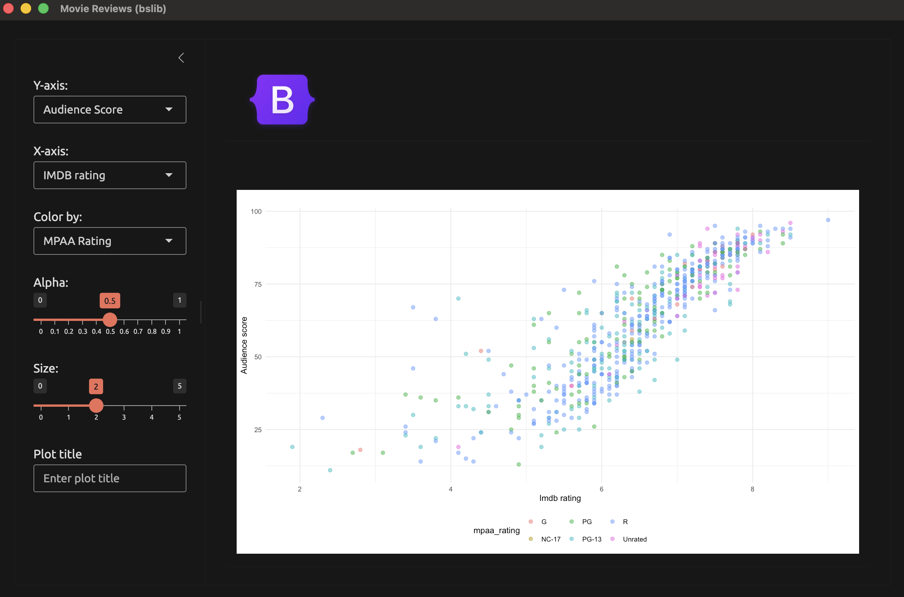
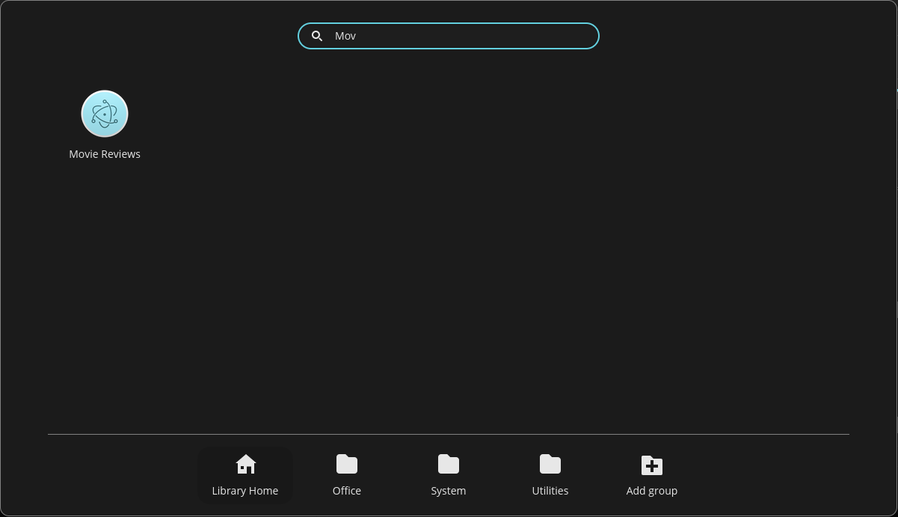

# shinyelectron {#sec-shinyelectron}

```{r}
#| eval: true
#| echo: false
#| include: false
source("_common.R")
```

```{r}
#| label: co_box_dev
#| echo: false
#| results: asis
#| eval: true
co_box(
  color = "y",
  look = "default",
  header = "Caution",
  contents = "The contents for this section are being developed. Thank you for your patience."
)
```

```{r}
#| label: co_box_tldr
#| echo: false
#| results: asis
#| eval: true
co_box(
  color = "b",
  look = "default", hsize = "1.05", size = "0.95",
  header = "TLDR",
  fold = TRUE,
  contents = "
  - `shinyelectron` converts a Shiny app into a desktop installer (`.dmg`, `.exe`, or `.AppImage`).

  - The runtime strategy decides how R reaches the user's computer: shinylive, bundled, auto-download, system, or container.

  - App-packages need a small launcher app in `electron/app/` that loads the package and returns a Shiny app object.

  - A GitHub Actions matrix builds installers for each operating system.

  - On Linux, the `shinylive` strategy builds an `.AppImage`, and electron-builder turns the same project into a `.deb`."
)
```

In the previous chapter we moved our app-package into the browser with `webR` and `shinylive` (@sec-webr). Some users need the app as a desktop program instead. They might work offline, or their organization might block unknown websites. In this chapter we'll use the `shinyelectron` package to turn `sap` into an installer that users download and open like any other program.

```{r}
#| label: shinypak_apps
#| echo: false
#| results: asis
#| eval: true
shinypak_apps(regex = "^23", branch = "23.1_shinyelectron")
```

## What is `shinyelectron`? {#sec-shinyelectron-what-is}

[Electron](https://www.electronjs.org/) is a framework for building desktop programs with web technologies. An Electron app is just a web browser with a single page, packaged as a program. Visual Studio Code and Slack are both built this way.

[`shinyelectron`](https://r-pkg.thecoatlessprofessor.com/shinyelectron/) wraps a Shiny app in Electron. It starts R (or `webR`), runs the app, and shows it in a desktop window. The user never sees a browser or a URL.

### Choosing a runtime strategy

The app still needs R, and `shinyelectron` offers five ways to provide it. Each strategy trades installer size against what the user's computer needs:

| Strategy | The installer ships | The user needs |
|:---|:---|:---|
| `shinylive` | Electron and a `webR` bundle | nothing |
| `bundled` | Electron and a portable copy of R | nothing |
| `auto-download` | Electron and a downloader | internet on first launch |
| `system` | Electron only | R installed |
| `container` | Electron and a container setup | Docker or Podman |

The diagram below shows how to choose between them:

```{mermaid}
%%| fig-align: center
%%| fig-cap: 'Choosing a shinyelectron runtime strategy'
%%{init: {'theme': 'base', 'themeVariables': { 'fontFamily': 'monospace', "fontSize":"16px", "darkMode":false}}}%%

flowchart TD
    Start(["App-package"]) --> Q1{"Every package<br>runs in webR?"}
    Q1 -->|"yes"| SL("<code>shinylive</code>")
    Q1 -->|"no"| Q2{"Users have R<br>installed?"}
    Q2 -->|"yes"| SYS("<code>system</code>")
    Q2 -->|"no"| Q3{"Heavy system<br>libraries?"}
    Q3 -->|"yes"| CON("<code>container</code>")
    Q3 -->|"no"| Q4{"Internet on<br>first launch?"}
    Q4 -->|"yes"| AD("<code>auto-download</code>")
    Q4 -->|"no"| BUN("<code>bundled</code>")

    style SL fill:#4CBB9D,color:#FFFFFF,rx:5,ry:5
    style SYS fill:#4CBB9D,color:#FFFFFF,rx:5,ry:5
    style CON fill:#4CBB9D,color:#FFFFFF,rx:5,ry:5
    style AD fill:#4CBB9D,color:#FFFFFF,rx:5,ry:5
    style BUN fill:#4CBB9D,color:#FFFFFF,rx:5,ry:5
```

We confirmed in @sec-webr-packages that every `sap` dependency runs in `webR`, so `shinylive` is an option. It also needs the R-universe binary from @sec-webr-r-universe. We'll use the `bundled` strategy in this chapter instead. It installs `sap` from our local source files, so it works without R-universe and runs the full version of R.

The `bundled` strategy has two limits. Portable R only exists for macOS and Windows, so it can't build Linux installers. It also can't cross-build, so macOS installers must be built on a Mac and Windows installers on Windows. We'll use the `shinylive` strategy for Linux in @sec-shinyelectron-deb.

## Preparing the build machine {#sec-shinyelectron-preflight}

You don't have to know JavaScript to use `shinyelectron`, but the computer that builds the installer needs a few tools. `shinyelectron` requires R (>= 4.5.0), [Node.js](https://nodejs.org/en) (>= 22.0.0), [npm](https://www.npmjs.com/) (>= 11.5.0), and each platform's build tools (Xcode Command Line Tools on macOS or Visual Studio Build Tools on Windows).

We'll install the development version of `shinyelectron` from GitHub and check the build machine with `sitrep_shinyelectron()`. 

The CRAN release (0.2.1) doesn't support the `local_packages` field we'll use to install `sap`, so we'll install teh development version for this chapter:

```{r}
#| eval: false
#| code-fold: false
pak::pak("coatless-rpkg/shinyelectron")
library(shinyelectron)
```

```{r}
#| eval: false
#| code-fold: false
sitrep_shinyelectron()
```

::: {style="font-style: italic;"}

```{verbatim}
sitrep_shinyelectron()

── Complete shinyelectron Diagnostic Report ──────────────────────────────────
──────────────────────────────────────────────────────────────────────────────

── System Requirements Report ────────────────────────────────────────────────
✔ Platform: mac
✔ Architecture: x64
ℹ Local Node.js (shinyelectron): Not installed
ℹ   Install with: `shinyelectron::install_nodejs()`
✔ Active Node.js: v22.14.0 (system)
✔ npm: v11.18.0
✔ R: v4.6.1

── Python ──

✔ Python 3.15.2
ℹ Python shinylive: not usable
ℹ   Install with: `pip install shinylive`
ℹ Python shiny: not usable
ℹ   Install with: `pip install shiny`

── Container Engine ──

✔ Container engine: docker

── Cached Runtimes ──

✔ Cached R runtimes: 4.6.1
✔ All system requirements satisfied
```

:::

The `System Requirements Report` confirms R, Node.js, and `npm` meet the minimum versions. The `Python` section only applies to Shiny for Python apps, and the `Container Engine` section only applies to the `container` strategy, so we can ignore both. `Cached Runtimes` lists the portable R versions `shinyelectron` has downloaded for the `bundled` strategy. This list is empty until the first `bundled` build downloads portable R.

::: {style="font-style: italic;"}

```{verbatim}
── Dependencies Report ───────────────────────────────────────────────────────

── Required Packages ──

✔ cli: v3.6.6
✔ fs: v2.1.0
✔ jsonlite: v2.0.0
✔ rappdirs: v0.3.4
✔ rlang: v1.3.0
✔ whisker: v0.4.1
✔ processx: v3.9.0
✔ yaml: v2.3.12
✔ utils: v4.6.1
✔ tools: v4.6.1

── Optional Packages ──

✔ shinylive: v0.5.0
ℹ DT: Not installed (optional)
✔ ggplot2: v4.0.3
✔ All required dependencies satisfied

── Recommendations ──

ℹ For full functionality, install optional packages with: install.packages(c("DT"))
```

:::

The `Dependencies Report` recommends installing `DT`, but `sap` doesn't use it, so we won't bother. 

::: {style="font-style: italic;"}

```{verbatim}
── Build Tools Report ────────────────────────────────────────────────────────
ℹ Checking build tools for platform: mac
✔ Xcode Command Line Tools: Found
✔ Build tools ready
```

:::

The `Build Tools Report` finds the Xcode Command Line Tools, the build tools `shinyelectron` requires on macOS. On Windows, this report checks for Visual Studio Build Tools instead.

::: {style="font-style: italic;"}

```{verbatim}
── Project Report ────────────────────────────────────────────────────────────
ℹ Checking directory: /Users/mjfrigaard/projects/apps/R/sap
✖ package.json: Not found
! main.js: Not found
✖ App files: Not found in src/app or app/
ℹ node_modules: Not found (run 'npm install')
ℹ This does not appear to be an Electron project
! Found 3 issues

── Recommendations ──

ℹ Run 'npm install' to install dependencies
──────────────────────────────────────────────────────────────────────────────

── Overall Summary ───────────────────────────────────────────────────────────
! Found 3 total issues that may prevent successful builds

── Priority Actions ──

ℹ 1. For full functionality, install optional packages with: install.packages(c("DT"))
ℹ 2. Run 'npm install' to install dependencies
```

:::

The `Project Report` flags a missing `package.json`, `main.js`, and app files because `sitrep_shinyelectron()` checks the current directory for an Electron project. `export()` creates that project in `electron/dist/electron-app/` during the build, so these issues (and the `npm install` recommendation) are expected before the first build. The `Overall Summary` counts these issues, but none of them will stop our build.

This machine already has Node.js v22.14.0 installed (`Active Node.js: v22.14.0 (system)`), so `shinyelectron` doesn't need its own copy. If Node.js is missing or too old, `install_nodejs()` installs it without administrator rights:

```{r}
#| eval: false
#| code-fold: false
install_nodejs()
```

These tools only matter on the build machine. The people who install our app don't need R, Node.js, or `npm`.

## The `electron/` folder {#sec-shinyelectron-folder}

`shinyelectron` exports an app directory, not a package. We'll keep our package untouched and add an `electron/` folder with a launcher app and a build script:

```{r}
#| label: git_box_23.1_shinyelectron
#| echo: false
#| results: asis
#| eval: true
git_margin_box(
  contents = "launch",
  fig_pw = '75%',
  branch = "23.1_shinyelectron",
  repo = 'sap')
```

::: {style="font-style: italic;"}

```{verbatim}
electron/
├── app/
│   ├── _shinyelectron.yml
│   └── app.R
└── build.R
```

:::

### The launcher app

The launcher in `electron/app/app.R` looks just like the `shinylive` launcher from @sec-webr-launcher:

```{r}
#| eval: false
#| code-fold: false
library(shiny)
library(sap)

shinyApp(
  ui = movies_ui(bslib = TRUE),
  server = movies_server
)
```

We return a Shiny app object for the same reason as before. `shinyelectron` manages the port and the R process, so the launcher can't call `launch_app()` (which calls `shiny::runApp()`). An app that starts its own server usually opens to a blank window.

### The configuration file

`_shinyelectron.yml` stores the build settings so we don't have to pass them to `export()` each time. Arguments passed to `export()` still override the file:

```yaml
app:
  name: "Movie Reviews" # <1>
  slug: "sap"
  version: "0.0.0-9200" # <2>
build:
  type: "r-shiny"
  runtime_strategy: "bundled" # <3>
  platforms:
    - mac
    - win
dependencies:
  auto_detect: true # <4>
  r:
    version: null
    local_packages:
      - "../.." # <5>
    repos:
      - "https://cloud.r-project.org"
window:
  width: 1200
  height: 800
```
1. The name in the window title and the installed program.
2. The semantic version form of the `Version` field in `DESCRIPTION` (`0.0.0.9200`). Electron requires three-part versions, so the development number goes after a hyphen.
3. Ships a portable copy of R with the app.
4. Scans `app.R` for `library()` calls to find dependencies.
5. Installs `sap` from the package root (relative to this file), with its dependencies from `repos`.

The `local_packages` field is how a `bundled` app installs a package that isn't on CRAN. It accepts a source folder or a `.tar.gz` file. A local package replaces any repository package with the same name.

### Ignoring the build files

The `electron/` folder isn't part of the R package, so we add it to `.Rbuildignore`. We also add the build output to `.gitignore`, because the installers are large and we can rebuild them at any time:

::: {.panel-tabset}

#### `.Rbuildignore`

```{verbatim}
^electron$
```

#### `.gitignore`

```{verbatim}
electron/dist/
```

:::

## Building the desktop app (`.dmg`) {#sec-shinyelectron-build}

We'll build the macOS installer (`.dmg`) on a Mac. The `23.2_shinyelectron-dmg` branch narrows the configuration file to a single platform (`platforms: mac`):

```{r}
#| label: git_box_23.2_shinyelectron-dmg
#| echo: false
#| results: asis
#| eval: true
git_margin_box(
  contents = "launch",
  fig_pw = '75%',
  branch = "23.2_shinyelectron-dmg",
  repo = 'sap')
```

The build script in `electron/build.R` checks the system, validates the app, and exports it. We run it from the package root:

```{r}
#| eval: false
#| code-fold: false
library(shinyelectron)

sitrep_shinyelectron()

platform <- "mac"

app_check("electron/app", platform = platform)

export(
  appdir = file.path(getwd(), "electron/app"),
  destdir = file.path(getwd(), "electron/dist"),
  platform = platform,
  overwrite = TRUE,
  run_after = interactive()
)
```

We pass `platform` to both `app_check()` and `export()`. A `bundled` build can only target the machine it runs on, so each build gets one platform. Without `platform`, `app_check()` reads every platform in the configuration file and reports an error when it finds more than one. `app_check()` catches configuration problems before the build starts. We pass absolute paths to `export()`, because the bundled R installs packages from a different working directory and can't resolve a relative library path.

`export()` installs portable R, installs `sap` and its dependencies, and builds the installer. `run_after = interactive()` opens the finished app when we run the script by hand, but not when it runs on a CI server.

The build prints a lot of output, so we'll walk through it in three stages. First, `export()` embeds portable R and installs the dependencies of `sap` into the bundled library:

::: {style="font-style: italic;"}

```{verbatim}
ℹ Embedding R runtime for bundled strategy...
ℹ Platform: mac, Architecture: x64
✔ R 4.6.1 already installed at /Users/mjfrigaard/Library/Caches/shinyelectron/assets/r/mac/x64/4.6.1
ℹ Installing packages with bundled R...
ℹ Installing 62 packages into bundled library
Portable R: patched 29 shared libraries
Warning message:
packages ‘methods’, ‘grDevices’, ‘tools’, ‘utils’, ‘graphics’, ‘stats’, ‘grid’ are base packages, and should not be updated
```

:::

* The warning about base packages is harmless. 

* `methods`, `utils`, and the other base packages ship with portable R, so the bundled R skips them.

Next, `export()` builds a source tarball of `sap` from the package root (the `local_packages` field) and installs it:

::: {style="font-style: italic;"}

```{verbatim}
ℹ Installing 1 local R package with bundled R: sap
ℹ Building a source tarball of sap...
WARNING: ignoring environment value of R_HOME
* checking for file ‘/Users/mjfrigaard/projects/apps/R/sap/DESCRIPTION’ ... OK
* preparing ‘sap’:
* checking DESCRIPTION meta-information ... OK
* checking for LF line-endings in source and make files and shell scripts
* checking for empty or unneeded directories
  NB: this package now depends on R (>= 3.5.0)
  WARNING: Added dependency on R >= 3.5.0 because serialized objects in
  serialize/load version 3 cannot be read in older versions of R.
  File(s) containing such objects:
    ‘sap/data/movies.RData’
    ‘sap/tests/testthat/fixtures/tidy_ggp2_movies.rds’
  NB: this package now depends on R (>= 4.1.0)
  WARNING: Added dependency on R >= 4.1.0 because package code uses the
  pipe |> or function shorthand \(...) syntax added in R 4.1.0.
  File(s) using such syntax:
    ‘display_type.R’ ‘mod_aes_input.R’ ‘mod_var_input.R’
* building ‘sap_0.0.0.9200.tar.gz’

ℹ Installing sap from source...
* installing *source* package ‘sap’ ...
...
* DONE (sap)
✔ Installed sap
ℹ Removed 1012 test and documentation files (32.2 MB) from the bundled R runtime
✔ Embedded R runtime
```

:::

* The `R_HOME` warning means the bundled R is using its own installation instead of ours, which is what we want.  
* The two `NB` warnings are worth fixing: 
  * The `DESCRIPTION` file of `sap` says `Depends: R (>= 2.10)`, but the package uses the native pipe (`|>`) and data saved in serialization version 3
  * `R CMD build` raises the requirement to R (>= 4.1.0) in the tarball, and we can silence the warning by changing `Depends` to match

Finally, `export()` installs the Electron dependencies with `npm`, builds the installer, and (because we ran the script interactively) opens the app:

::: {style="font-style: italic;"}

```{verbatim}
ℹ Installing npm dependencies...
npm warn deprecated inflight@1.0.6: This module is not supported, and leaks memory. ...
...
16 vulnerabilities (15 moderate, 1 high)
...
npm warn allow-scripts 2 packages have install scripts not yet covered by allowScripts:
npm warn allow-scripts   electron@41.10.7 (postinstall: node install.js)
npm warn allow-scripts   electron-winstaller@5.4.0 (install: node ./script/select-7z-arch.js)
✔ Installed npm dependencies
ℹ Building for platforms: mac
ℹ Building for mac-x64...
✔ Built for mac-x64
✔ Successfully built Electron app: /Users/mjfrigaard/projects/apps/R/sap/electron/dist/electron-app
✔ Successfully exported Shiny application to Electron!
ℹ Output directory: /Users/mjfrigaard/projects/apps/R/sap/electron/dist
ℹ Electron app: /Users/mjfrigaard/projects/apps/R/sap/electron/dist/electron-app
ℹ Distributables: /Users/mjfrigaard/projects/apps/R/sap/electron/dist/electron-app/dist
ℹ Starting application in development mode...
...
[lifecycle] finding_runtime: Looking for R...
[lifecycle] runtime_found: Found bundled R
[lifecycle] starting_server: Starting R Shiny server...
[lifecycle] starting_server: Loading package: shiny
[lifecycle] starting_server: R server listening, loading app...
[lifecycle] server_ready: R Shiny server ready
Server ready on port 3838
```

:::

* The `npm` warnings come from the build tools (`electron-builder` and its dependencies), not from our app, and they only affect the build machine.  
* The `[lifecycle]` messages show the app finding the bundled R and starting the Shiny server. In development mode, Electron also prints a Content Security Policy warning and a few `GPU` errors.  
* The security warning says it won't appear once the app is packaged, and the `GPU` errors are Chromium log messages that don't affect the app. 

The installers are written to `electron/dist/electron-app/dist/`:

::: {style="font-style: italic;"}

```{verbatim}
electron/dist/electron-app/dist/
├── builder-debug.yml
├── mac/
│   └── Movie Reviews.app
├── sap-0.0.0-9200-x64.dmg
└── sap-0.0.0-9200-x64.dmg.blockmap
```

:::

On an Intel Mac, the build produces `sap-0.0.0-9200-x64.dmg` (about 256 MB, most of it portable R). The `.dmg` is the only file we share with users. 

* `mac/Movie Reviews.app` is the unpacked app that goes inside the `.dmg`, the `.blockmap` file is used for automatic updates, and `builder-debug.yml` records the `electron-builder` settings for troubleshooting.  
* The window that opens at the end of the build runs in development mode, from the Electron project in `electron/dist/electron-app/` (*it shows the app works, but not that the installer does*). 

To check the installer, we open the `.dmg`, drag **Movie Reviews** into `Applications`, and open it like any other program:

{width='100%' fig-align='center'}

We haven't configured an icon, so the installed app uses the default Electron icon (`app_check()` reports `Icon: not configured`):

{width='10%' fig-align='center'}

### Debugging the packaged app

If the packaged app misbehaves, launch it with the `SHINYELECTRON_DEBUG` environment variable set to `1`. The debug output shows how the app found R, which packages it installed, and whether the Shiny server started.

```{r}
#| label: co_box_rprofile
#| echo: false
#| results: asis
#| eval: true
co_box(
  color = "r",
  look = "default", hsize = "1.05", size = "0.95",
  header = "Your `.Rprofile` comes along",
  fold = TRUE,
  contents = "
The bundled R reads `~/.Rprofile` twice: when `export()` installs packages, and when the app starts. If that file calls a package the app doesn't include (for example, `ellmer::chat_anthropic()` in `options()`), R stops with `there is no package called 'ellmer'`. During the build, `export()` fails while installing packages. In the packaged app, R stops before the Shiny server starts. To test the app without your own profile, launch it with `R_PROFILE_USER` pointing to an empty file. To fix it everywhere, wrap the call in `if (requireNamespace('ellmer', quietly = TRUE))` in your `~/.Rprofile`."
)
```

## Building installers with GitHub Actions {#sec-shinyelectron-gha}

Because `bundled` can't cross-build, a single computer can't build installers for every platform. A GitHub Actions matrix solves this by running the same job on a macOS runner and a Windows runner. The workflow is in `.github/workflows/build-installers.yml` on the `23.1_shinyelectron` branch:

```yaml
name: build-installers, sap

on:
  workflow_dispatch: # <1>

jobs:
  build:
    strategy:
      fail-fast: false
      matrix:
        include: # <2>
          - { os: macos-latest,   platform: mac, arch: arm64 }
          - { os: windows-latest, platform: win, arch: x64 }
    runs-on: ${{ matrix.os }}

    steps:
      - uses: actions/checkout@v4

      - uses: r-lib/actions/setup-r@v2

      - uses: r-lib/actions/setup-r-dependencies@v2
        with:
          extra-packages: local::. # <3>

      - uses: coatless-actions/shiny-to-electron@v1 # <4>
        with:
          appdir: electron/app
          app-name: Movie Reviews
          platform: ${{ matrix.platform }}
          arch: ${{ matrix.arch }}
```
1. Runs only when we start it from the Actions tab.
2. One job per platform. Linux is left out because `bundled` can't target it.
3. Installs `sap` from the checked out repository.
4. Builds the Electron installer for the runner's platform.

`workflow_dispatch` keeps the workflow from running on every push, since each build takes several minutes per platform. When you're ready to publish, add a `push: tags` trigger and a release job that attaches the installers to a GitHub release.

```{r}
#| label: co_box_signing
#| echo: false
#| results: asis
#| eval: true
co_box(
  color = "r",
  look = "default", hsize = "1.05", size = "0.95",
  header = "Unsigned apps",
  fold = TRUE,
  contents = "
macOS and Windows warn users before they open an unsigned app, and macOS may refuse to open it at all. `export(sign = TRUE)` signs the build with credentials stored in environment variables (for example, `CSC_LINK`, `CSC_KEY_PASSWORD`, and `APPLE_ID`). Store these as GitHub Actions secrets and never write them into a file in the repository."
)
```

## Building a Linux installer (`.deb`) {#sec-shinyelectron-deb}

Linux users expect a `.deb` file,  the package format for Debian, Ubuntu, and Pop!_OS (which I'm currently using). `shinyelectron` doesn't build a `.deb` installer, because Linux only builds an `.AppImage` (a single file that runs without being installed). I've found we can still get a `.deb` by building the `.AppImage` first, then *rebuilding* the same Electron project with one extra target.

```{r}
#| label: git_box_23.3_shinyelectron-deb
#| echo: false
#| results: asis
#| eval: true
git_margin_box(
  contents = "launch",
  fig_pw = '75%',
  branch = "23.3_shinyelectron-deb",
  repo = 'sap')
```

The `bundled` strategy won't work with Pop!_OS, because portable R doesn't exist for Linux. But we can switch to the `shinylive` strategy, which runs `sap` with `webR` *inside* the Electron window. The diagram below shows the full build:

```{mermaid}
%%| fig-align: center
%%| fig-cap: 'Building a .deb with shinyelectron and electron-builder'
%%{init: {'theme': 'base', 'themeVariables': { 'fontFamily': 'monospace', "fontSize":"16px", "darkMode":false}}}%%

flowchart TD
    Start(["<code>electron/build.R</code>"]) -->|"i. export()"| Export("shinyelectron converts the app<br>to shinylive and builds Electron")
    Export --> AppImage[/".AppImage"/]
    Export --> Project[("<code>electron-app/</code><br>Electron project")]
    Project -->|"ii. edit package.json"| Edit("add the <code>deb</code> target,<br>homepage, and maintainer")
    Edit -->|"iii. npx electron-builder"| Builder("electron-builder<br>packages the project")
    Builder --> Deb[/".deb"/]

    style Export fill:#4CBB9D,color:#FFFFFF,rx:5,ry:5
    style Edit fill:#4CBB9D,color:#FFFFFF,rx:5,ry:5
    style Builder fill:#4CBB9D,color:#FFFFFF,rx:5,ry:5
```

### Preparing the Linux build machine

The Linux build machine needs the same tools as before. The default Node.js on Ubuntu 24.04 (and Pop!_OS) is version 18, which is too old for `shinyelectron`. 
```{r}
#| eval: false
#| code-fold: false
library(shinyelectron)
```

`install_nodejs()` installs a newer version without administrator rights:

```{r}
#| eval: false 
#| code-fold: false
install_nodejs()
```

::: {style="font-style: italic;"}

```{verbatim}
ℹ Detecting latest Node.js LTS version...
✔ Latest LTS: v26.13.0

── Installing Node.js v26.13.0 ─────────────────────────────────────────────
ℹ Platform: linux
ℹ Architecture: x64
ℹ Fetching checksums...
ℹ Downloading from <https://nodejs.org/dist/v26.13.0/node-v26.13.0-linux-x64.tar.gz>
trying URL 'https://nodejs.org/dist/v26.13.0/node-v26.13.0-linux-x64.tar.gz'
Content type 'application/gzip' length 62893692 bytes (60.0 MB)
==================================================
downloaded 60.0 MB

ℹ Verifying checksum...
✔ Checksum verified
ℹ Extracting archive...
✔ Node.js v26.13.0 installed successfully
ℹ Location: /home/mjfrigaard/.cache/shinyelectron/assets/nodejs/v26.13.0/linux-x64
ℹ shinyelectron will automatically use this installation
```

:::

The `shinylive` strategy needs two things from @sec-webr. The first is the `shinylive` R package, which converts the app before Electron packages it. `sitrep_shinyelectron()` lists `shinylive` as optional, but this strategy can't build without it:

```{r}
#| eval: false
#| code-fold: false
install.packages("shinylive")
```

The second is the `WebAssembly` binary of `sap` from @sec-webr-r-universe. We install `sap` from R-universe before we build:

```{r}
#| eval: false
#| code-fold: false
install.packages(
  "sap",
  repos = c("https://mjfrigaard.r-universe.dev", getOption("repos"))
)
```

We can confirm the build machine is ready with `sitrep_shinyelectron()`.

```{r}
#| eval: false 
#| code-fold: false
sitrep_shinyelectron()
```

The `System Requirements Report` shows `shinyelectron` is using the local copy of Node.js we installed with `install_nodejs()` (`Active Node.js: v26.13.0 (local)`). `Cached Runtimes` reports no cached runtimes, which is expected because the `shinylive` strategy runs `sap` with `webR` and never downloads portable R.

The `Dependencies Report` confirms the required packages are installed. The `Optional Packages` section should now list `shinylive` with a version number:

::: {style="font-style: italic;"}

```{verbatim}
── Complete shinyelectron Diagnostic Report ────────────────────────────────
────────────────────────────────────────────────────────────────────────────

── System Requirements Report ──────────────────────────────────────────────
✔ Platform: linux
✔ Architecture: x64
✔ Local Node.js (shinyelectron): v26.13.0
✔ Active Node.js: v26.13.0 (local)
✔ npm: v11.20.0
✔ R: v4.6.1

── Python ──

✔ Python 3.12.3
ℹ Python shinylive: not usable
ℹ   Install with: `pip install shinylive`
ℹ Python shiny: not usable
ℹ   Install with: `pip install shiny`

── Container Engine ──

✔ Container engine: docker

── Cached Runtimes ──

ℹ No cached runtimes found
✔ All system requirements satisfied
────────────────────────────────────────────────────────────────────────────

── Dependencies Report ─────────────────────────────────────────────────────

── Required Packages ──

✔ cli: v3.6.6
✔ fs: v2.1.0
✔ jsonlite: v2.0.0
✔ rappdirs: v0.3.4
✔ rlang: v1.3.0
✔ whisker: v0.4.1
✔ processx: v3.9.0
✔ yaml: v2.3.12
✔ utils: v4.6.1
✔ tools: v4.6.1

── Optional Packages ──

✔ shinylive: v0.5.0
✔ DT: v0.34.0
✔ ggplot2: v4.0.3
✔ All required dependencies satisfied
────────────────────────────────────────────────────────────────────────────
```

:::


The `Build Tools Report` finds `gcc` and `make`, and the `Project Report` flags the same missing Electron project files we saw in @sec-shinyelectron-preflight:


::: {style="font-style: italic;"}

```{verbatim}
── Build Tools Report ──────────────────────────────────────────────────────
ℹ Checking build tools for platform: linux
✔ Build tools (gcc, make): Found
✔ Build tools ready
────────────────────────────────────────────────────────────────────────────

── Project Report ──────────────────────────────────────────────────────────
ℹ Checking directory: /home/mjfrigaard/projects/apps/R/sap
✖ package.json: Not found
! main.js: Not found
✖ App files: Not found in src/app or app/
ℹ node_modules: Not found (run 'npm install')
ℹ This does not appear to be an Electron project
! Found 3 issues

── Recommendations ──

ℹ Run 'npm install' to install dependencies
────────────────────────────────────────────────────────────────────────────

── Overall Summary ─────────────────────────────────────────────────────────
! Found 3 total issues that may prevent successful builds

── Priority Actions ──

ℹ 1. Run 'npm install' to install dependencies
```

:::


```{r}
#| label: co_box_npm_install
#| echo: false
#| results: asis
#| eval: true
co_box(
  color = "r",
  look = "default", hsize = "1.05", size = "0.95",
  header = "Don't run `npm install` in the package root",
  contents = "
Don't run `npm install` in the package root; it would add `package.json` and `node_modules/` to the R package."
)
```

### The Linux configuration file

The launcher in `electron/app/app.R` doesn't change. The configuration file switches the strategy and the platform:

```yaml
app:
  name: "Movie Reviews"
  slug: "sap"
  version: "0.0.0-9200"
build:
  type: "r-shiny"
  runtime_strategy: "shinylive" # <1>
  platforms:
    - linux # <2>
window:
  width: 1200
  height: 800
```
1. Runs `sap` with `webR`, so the installer doesn't need portable R.
2. Builds for Linux only.

We've dropped the `dependencies` block. The `shinylive` strategy bundles the `WebAssembly` binaries of the installed packages, so it doesn't install anything from `local_packages`.

### The Linux build script

The build script in `electron/build.R` runs in two stages. `export()` builds the `.AppImage`, then the script edits the Electron project and calls `electron-builder` to build the `.deb`:

```{r}
#| eval: false
#| code-fold: false
library(shinyelectron)

sitrep_shinyelectron()

app_check("electron/app", platform = "linux")

export( # <1>
  appdir = file.path(getwd(), "electron/app"),
  destdir = file.path(getwd(), "electron/dist"),
  platform = "linux",
  overwrite = TRUE
)

electron_app <- file.path(getwd(), "electron/dist/electron-app")

pkg_json <- file.path(electron_app, "package.json")

pkg <- jsonlite::read_json(pkg_json)

pkg$homepage <- "https://github.com/mjfrigaard/sap" # <2>

pkg$build$linux$target <- list("AppImage", "deb") # <3>

pkg$build$linux$maintainer <- "Martin Frigaard <mjfrigaard@pm.me>" # <4>

jsonlite::write_json(pkg, pkg_json, auto_unbox = TRUE, pretty = TRUE)

node_bin <- utils::tail(Sys.glob(file.path( # <5>
  rappdirs::user_cache_dir("shinyelectron"), "assets/nodejs/*/linux-x64/bin"
)), 1) # <5>

withr::with_path(node_bin, withr::with_dir( # <6>
  electron_app,
  system2("npx", c("electron-builder", "--linux", "deb", "--publish", "never"))
)) # <6>
```
1. Converts the app to `shinylive`, writes the Electron project to `electron/dist/electron-app/`, and builds the `.AppImage`.
2. The project's web page, required for a `.deb`.
3. Adds `deb` to the Linux targets (`shinyelectron` only sets `AppImage`).
4. The package maintainer, also required for a `.deb`.
5. Finds the Node.js that `install_nodejs()` installed in the `shinyelectron` cache.
6. Puts that Node.js first on the `PATH`, then runs `electron-builder` from inside the Electron project. Without it, `npx` uses the system Node.js (version 18 on Ubuntu 24.04).

We can't skip the first build with `export(build = FALSE)`. That option stops after the `shinylive` conversion, before `shinyelectron` writes the Electron project, so there's no `package.json` to edit.

The homepage and maintainer fields matter because `electron-builder` refuses to build a `.deb` without them:

::: {style="font-style: italic;"}

```{verbatim}
Error: Please specify project homepage
Please specify author 'email' in the application package.json
It is required to set Linux .deb package maintainer.
```

:::

```{r}
#| label: co_box_version_mismatch
#| echo: false
#| results: asis
#| eval: true
co_box(
  color = "b",
  look = "default", hsize = "1.05", size = "0.95",
  header = "Package version warnings",
  fold = TRUE,
  contents = "
`export()` may warn that an installed package (for example, `knitr` or `xfun`) is a version behind its `WebAssembly` build. The `shinylive` conversion uses the `WebAssembly` version, so the app still works. Update the local package to silence the warning."
)
```

### Checking the `.deb`

The installers are written to `electron/dist/electron-app/dist/`:

::: {style="font-style: italic;"}

```{verbatim}
sap-0.0.0-9200-amd64.deb          183 MB
sap-0.0.0-9200-x86_64.AppImage    211 MB
```

:::

We can confirm the package details before we install it with `dpkg-deb`:

```{bash}
#| eval: false
#| code-fold: false
#| echo: true
dpkg-deb -f electron/dist/electron-app/dist/sap-0.0.0-9200-amd64.deb \
  Package Version Architecture Maintainer Homepage
```

::: {style="font-style: italic;"}

```{verbatim}
Package: sap
Version: 0.0.0~9200
Architecture: amd64
Maintainer: Martin Frigaard <mjfrigaard@pm.me>
Homepage: https://github.com/mjfrigaard/sap
```

:::

`electron-builder` converts the hyphen in our version to a tilde (`0.0.0~9200`), which Debian reads as a pre-release version.

### Installing the `.deb`

We install the package with `dpkg`, which needs administrator rights. Run this from the package root:

```{bash}
#| eval: false
#| code-fold: false
#| echo: true
sudo dpkg -i electron/dist/electron-app/dist/sap-0.0.0-9200-amd64.deb
```

::: {style="font-style: italic;"}

```{verbatim}
Selecting previously unselected package sap.
(Reading database… 479036 files and directories currently installed.)
Preparing to unpack …/dist/sap-0.0.0-9200-amd64.deb…
Unpacking sap (0.0.0~9200)…
Setting up sap (0.0.0~9200)…
update-alternatives: using /opt/Movie Reviews/sap to provide /usr/bin/sap (sap) in auto mode
Processing triggers for desktop-file-utils (0.27-2build1)…
Processing triggers for gnome-menus (3.36.0-1.1ubuntu3)…
Processing triggers for hicolor-icon-theme (0.17-2)…
```

:::

The app installs to `/opt/Movie Reviews/` and adds **Movie Reviews** to the Applications launcher:

{width='80%' fig-align='center'}

The `update-alternatives` line in the output also adds a `sap` command, so we can start the app from a terminal by typing `sap`.

The first launch takes a few seconds while `webR` loads `sap` and its dependencies. We can confirm it worked when the scatter plot appears in the window.

We remove the app with the package name from the `Package` field. The `-P` (purge) option removes the app and `dpkg`'s record of it in one step:

```{bash}
#| eval: false
#| code-fold: false
#| echo: true
sudo dpkg -P sap
```

::: {style="font-style: italic;"}

```{verbatim}
(Reading database… 479120 files and directories currently installed.)
Removing sap (0.0.0~9200)…
update-alternatives: warning: alternative /opt/Movie Reviews/sap (part of link group sap) doesn't exist; removing from list of alternatives
update-alternatives: warning: /etc/alternatives/sap is dangling; it will be updated with best choice
Purging configuration files for sap (0.0.0~9200)…
Processing triggers for hicolor-icon-theme (0.17-2)…
Processing triggers for desktop-file-utils (0.27-2build1)…
Processing triggers for gnome-menus (3.36.0-1.1ubuntu3)…
```

:::

The two `update-alternatives` warnings are expected. The package's removal script cleans up the `sap` command after `dpkg` has already deleted the app's files, so it warns about the missing files and then removes the link anyway.

## Recap {.unnumbered}

`shinyelectron` turns our app-package into a desktop program without changing the package itself. All the desktop code lives in the `electron/` folder.

```{r}
#| label: co_box_recap
#| echo: false
#| results: asis
#| eval: true
co_box(
  color = "g",
  fold = FALSE,
  look = "default", hsize = "1.05", size = "0.95",
  header = "Recap",
  contents = "
\n
1. Pick a runtime strategy based on where the app's packages run and what the user's computer has.

2. Add a launcher `app.R` that returns a Shiny app object, and store the build settings in `_shinyelectron.yml`.

3. Use `local_packages` to install an app-package that isn't on CRAN.

4. Build each platform's installer on that platform, either locally or with a GitHub Actions matrix.

5. On Linux, use the `shinylive` strategy, then add the `deb` target to `package.json` and rebuild with electron-builder.")
```

In the next chapter we'll build a package website for `sap` with `pkgdown` (@sec-pkgdown).

```{r}
#| label: git_contrib_box
#| echo: false
#| results: asis
#| eval: true
git_contrib_box()
```
